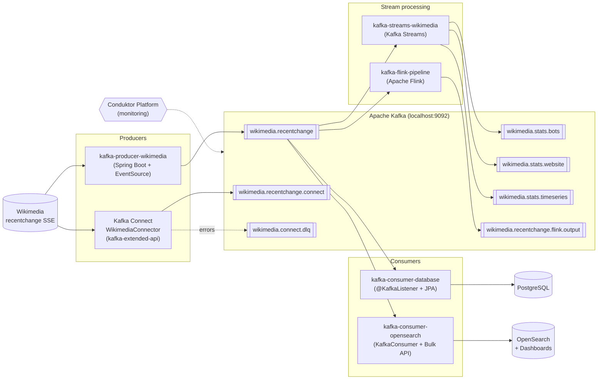

# apache-kafka-training-tasks

A project that collects hands-on training tasks on Apache Kafka (Spring Boot, Kafka Streams, Kafka Connect, Flink).
The data source is the public **Wikimedia Recent Changes** SSE stream
(`https://stream.wikimedia.org/v2/stream/recentchange`).

## Architecture



## Modules and use cases

| Module | Use case | Key concepts |
|---|---|---|
| [kafka-producer-wikimedia](kafka-producer-wikimedia) | Reads the Wikimedia stream via `EventSource` and publishes each event (JSON as `String`, keyed by website) to the `wikimedia.recentchange` topic | `KafkaTemplate`, `StringSerializer`, topic auto-creation via `NewTopic`/`TopicBuilder`, message keys, custom `Partitioner`, `EventHandler` |
| [kafka-consumer-database](kafka-consumer-database) | Persists every event from the topic into PostgreSQL | `@KafkaListener`, consumer group `myGroup`, `auto-offset-reset: earliest`, Spring Data JPA |
| [kafka-consumer-opensearch](kafka-consumer-opensearch) | Indexes events into OpenSearch (`wikimedia` index) for search and visualization | Plain `KafkaConsumer`, manual offset commits (`enable.auto.commit=false`), batch inserts via Bulk API, idempotency (`meta.id` as document id), graceful shutdown (`wakeup()`), `docker-compose` with OpenSearch and Dashboards |
| [kafka-streams-wikimedia](kafka-streams-wikimedia) | Computes real-time statistics and writes them to separate topics | See below |
| [kafka-extended-api](kafka-extended-api) | Kafka Connect (standalone) configuration with the Wikimedia source connector | `connect-standalone.properties`, `WikimediaConnector`, `JsonConverter`, Dead Letter Queue (`errors.tolerance=all`) |
| [kafka-flink-pipeline](kafka-flink-pipeline) | Reads `wikimedia.recentchange`, transforms (maps) messages and writes them to `wikimedia.recentchange.flink.output` | `FlinkKafkaConsumer`/`FlinkKafkaProducer`, `MapFunction`, custom `WikimediaData` (de)serializers, `setStartFromEarliest()` |
| [conduktor-platform](conduktor-platform) | Docker Compose for Conduktor Platform, a UI for browsing topics, messages and consumer groups | Cluster monitoring and administration |

### Kafka Streams: statistics

All three topologies read from `wikimedia.recentchange`:

| Topology | What it counts | Window | Output topic | State store |
|---|---|---|---|---|
| `BotCountStreamBuilder` | Changes made by bots vs. non-bots | none | `wikimedia.stats.bots` | `bot-count-store` |
| `WebsiteCountStreamBuilder` | Changes per website (`server_name`) | tumbling, 1 min | `wikimedia.stats.website` | `website-count-store` |
| `EventCountTimeseriesBuilder` | Total event count (time series) | tumbling, 10 s | `wikimedia.stats.timeseries` | `event-count-store` |

Operations used: `mapValues`, `selectKey`, `groupBy`/`groupByKey`, `windowedBy`, `count`, `toStream`, `to`.

## Running

Requirements: JDK, Maven, Kafka on `localhost:9092`.

```bash
# build all modules and run the tests (Docker must be running, see Testing)
mvn clean install

# or build without tests
mvn clean install -DskipTests

# supporting infrastructure
docker compose -f kafka-consumer-opensearch/docker-compose.yaml up -d   # OpenSearch :9200, Dashboards :5601
docker compose -f conduktor-platform/platform-docker-compose.yml up -d  # Conduktor Platform
```

`kafka-consumer-database` expects PostgreSQL on `localhost:5432` (database `wikimedia`).
Each module runs as a separate Spring Boot application (`mvn spring-boot:run -pl <module>`).

## Dependency updates (Dependabot)

Dependencies are kept up to date by [Dependabot](.github/dependabot.yml), which checks weekly (max 5 open PRs per entry):

- **Maven**: the root `pom.xml` and each module (`kafka-consumer-database`, `kafka-consumer-opensearch`, `kafka-extended-api`, `kafka-flink-pipeline`, `kafka-producer-wikimedia`, `kafka-streams-wikimedia`). Modules are listed separately because Dependabot does not descend into sub-modules on its own.
- **Docker Compose**: `kafka-consumer-opensearch` and `conduktor-platform` images.

Pull request policy:

- **Linear history**: merge commits are disabled in the repository. Merge PRs with rebase (or squash), e.g. `gh pr merge <number> --rebase`.
- **Safe to merge**: patch/minor bumps whose build passes (`mvn test-compile`).
- **Closed with `@dependabot ignore this major version`**: breaking upgrades that need a dedicated migration, for example Spring Boot 4.x, `okhttp-eventsource` 5.x/6.x and Confluent Platform 8.x (drops ZooKeeper).
- **Upgrade together**: OpenSearch client and server (`opensearch-rest-high-level-client` and the `opensearch` / `opensearch-dashboards` images), and the Conduktor Platform and Cortex images.
- Every PR runs the [CI workflow](.github/workflows/ci.yml) (see [CI](#ci)); merge only when it is green. GitHub Actions versions are also updated by Dependabot.

## Security

- **Vulnerable transitive dependencies** are pinned to patched versions in the root `pom.xml` and in the four modules that use the Spring Boot parent directly (Spring Boot properties plus `dependencyManagement`): `jackson-core`, `log4j-api`, `postgresql`, `commons-lang3`, `lz4-java`, `snappy-java`, `commons-io`, `commons-compress`, `okhttp` and `okio`. The Flink module replaces `org.lz4:lz4-java` with the maintained `at.yawk.lz4` fork.
- **Scanning**: resolved dependencies can be checked against [OSV](https://osv.dev) (for example with `osv-scanner`); GitHub Dependabot alerts are also available in the repository's Security tab.
- **Known open issue**: `org.opensearch:opensearch:1.2.4` (GHSA-6g3j-p5g6-992f). Fixing it needs a coordinated OpenSearch client and server upgrade.
- **Credentials**: `kafka-consumer-database` reads the database settings from `DB_URL`, `DB_USERNAME` and `DB_PASSWORD` (defaults are for local development only). The passwords in `conduktor-platform` (`change_me`, `admin`) are also local defaults, so do not expose that stack publicly.

## CI

[`.github/workflows/ci.yml`](.github/workflows/ci.yml) runs on every pull request and on pushes to `master`:

| Job | What it checks |
|---|---|
| **Build and test (JDK 17)** | `mvn verify`: compiles, runs the Testcontainers integration tests (Kafka, PostgreSQL, OpenSearch) and packages all modules |
| **Validate docker-compose files** | `docker compose config` for `conduktor-platform` and `kafka-consumer-opensearch` |
| **Dependency review** (PRs only) | Fails the PR if it introduces a dependency with a known vulnerability of high severity or above |

To make the checks required, enable branch protection for `master` (Settings → Branches) and select the three jobs above as required status checks.

## Testing

Tests are integration tests that start real infrastructure in Docker with [Testcontainers](https://testcontainers.com), so **Docker must be running** to execute `mvn verify` (CI uses the Docker preinstalled on GitHub runners). No local Kafka, PostgreSQL or internet access to Wikimedia is needed.

| Module | Test | What it verifies |
|---|---|---|
| `kafka-producer-wikimedia` | `KafkaProducerWikimediaApplicationTests` | The topic is created on startup and an event received from the stream handler is published to Kafka (the live Wikimedia stream is mocked) |
| `kafka-consumer-database` | `KafkaConsumerDatabaseApplicationTests` | Messages published to Kafka are persisted to PostgreSQL by the `@KafkaListener` |
| `kafka-consumer-opensearch` | `OpenSearchConsumerTest` | Events are indexed into OpenSearch using `meta.id` as the document id, so duplicates do not create extra documents |
| `kafka-streams-wikimedia` | `KafkaStreamsWikimediaTopologyTest` | The real topology produces bot/non-bot counts, per-website counts and the event-count time series |

`kafka-flink-pipeline` and `kafka-extended-api` have no tests yet. First runs are slower because the container images (for example OpenSearch 1.2.4) are pulled. Run a single module with `mvn -pl kafka-consumer-database test`.

## Roadmap

The roadmap follows the four stages of the course and is split into incremental tasks. Each task builds on the previous
ones and, where possible, extends an existing module so the Wikimedia stream stays the common data source.

**Legend** — difficulty: 🟢 beginner · 🟡 intermediate · 🔴 advanced. Status: ✅ done · 🚧 partly done · ⬜ not started.

| Stage | Focus | Status |
|---|---|---|
| 1. Core concepts and API | Topics, producers, consumers, offsets, delivery guarantees | 🚧 topics (1.1) and keys (1.2) done, reliability and tuning missing |
| 2. Kafka Extended API | Kafka Connect, Schema Registry, Avro, REST Proxy | 🚧 Connect configs only, `Main` is a stub |
| 3. Stream processing | Kafka Streams, exactly-once, joins, Flink | 🚧 stateful Streams and Flink map done |
| 4. Administration, production, security | AdminClient, multi-broker cluster, TLS/SASL/ACLs, monitoring, testing | ⬜ not started |

### Stage 1. Core concepts and API

**1.1 Topics, partitions and replication** 🟢 ✅ (`kafka-producer-wikimedia`)
The topic is declared explicitly: 3 partitions, replication factor 1 (single local broker), `retention.ms` of 7 days and
`cleanup.policy=delete`, all configurable in `application.yaml`. See the [module README](kafka-producer-wikimedia/README.md)
for the `kafka-topics --describe` output explained line by line.
*You learn:* topic/partition/replica model, leaders and ISR, retention (`retention.ms`, `retention.bytes`), why partition count matters.
*Done:* `wikimedia.recentchange` has 3 partitions and a documented retention, verified by an integration test.

**1.2 Message keys and partitioning** 🟢 ✅ (`kafka-producer-wikimedia`)
Events are sent with `server_name` as the key, and a custom `WikimediaPartitioner` isolates the hot websites on partition 0.
See the [module README](kafka-producer-wikimedia/README.md#message-keys-and-partitioning).
*You learn:* default key hashing, per-key ordering guarantees, hot partitions, why changing the partition count breaks key placement.
*Done:* a test shows that events with one key are consumed in order from one partition.

**1.3 Producer reliability** 🟡 ⬜ (`kafka-producer-wikimedia`)
Configure `acks=all`, `enable.idempotence=true`, `retries`, `delivery.timeout.ms` and `min.insync.replicas`. Use send callbacks
(`CompletableFuture` from `KafkaTemplate`) to log failures and metadata.
*You learn:* delivery guarantees, duplicates and reordering on retries, how idempotence fixes them, trade-off between latency and durability.
*Done when:* you can stop a broker (see 4.2) and show that no acknowledged message is lost.

**1.4 Producer throughput tuning** 🟡 ⬜ (`kafka-producer-wikimedia`)
Experiment with `linger.ms`, `batch.size` and `compression.type` (`snappy`, `lz4`, `zstd`). Compare results with `kafka-producer-perf-test.sh`.
*You learn:* batching, compression, the latency/throughput trade-off, how to measure instead of guess.
*Done when:* a short table in the module compares settings by throughput and latency.

**1.5 Consumer groups and rebalancing** 🟢 🚧 (`kafka-consumer-database`)
Run two or three instances of the same consumer, watch partitions being assigned, and check lag with `kafka-consumer-groups.sh`.
Then try more consumers than partitions.
*You learn:* group coordination, partition assignment, scaling limits (consumers ≤ partitions), lag as a health metric.
*Done when:* you can predict which instance gets which partition and show lag growing and shrinking.

**1.6 Offsets and delivery semantics** 🟡 🚧 (`kafka-consumer-opensearch`)
The OpenSearch consumer already commits manually after a bulk insert (at-least-once). Add `seek`/`seekToBeginning` to replay
data, compare `auto-offset-reset` values, and switch the database consumer to manual acknowledgment.
*You learn:* at-most-once vs at-least-once vs exactly-once, `__consumer_offsets`, replaying history, committing before vs after processing.
*Done when:* killing a consumer mid-batch leads to re-processing but no data loss, and you can explain why.

**1.7 Idempotent consumers** 🟡 ⬜ (`kafka-consumer-database`)
At-least-once delivery means duplicates. Add a unique constraint on `meta.id` in PostgreSQL (OpenSearch already uses it as the
document id) and handle the duplicate-key case.
*You learn:* idempotent processing as the practical answer to duplicates, choosing a business key.
*Done when:* replaying the topic does not create duplicate rows.

**1.8 Rebalance strategies** 🔴 ⬜ (`kafka-consumer-opensearch`)
Use `CooperativeStickyAssignor`, static membership (`group.instance.id`) and a `ConsumerRebalanceListener` that commits offsets on revoke.
*You learn:* eager vs incremental rebalancing, stop-the-world pauses, how to avoid them during rolling restarts.
*Done when:* restarting one consumer does not pause the whole group.

**1.9 Error handling, retries and dead-letter topic** 🟡 ⬜ (`kafka-consumer-database`)
Handle a "poison pill" (invalid JSON) with `DefaultErrorHandler`, back-off and `@RetryableTopic` / `DeadLetterPublishingRecoverer`.
*You learn:* retryable vs non-retryable errors, blocking vs non-blocking retries, DLT inspection and reprocessing.
*Done when:* a bad message ends up in `wikimedia.recentchange.DLT` and the consumer keeps going.

### Stage 2. Kafka Extended API

**2.1 Kafka Connect source connector** 🟡 🚧 (`kafka-extended-api`)
The standalone and connector configs exist. Make them work: fix the Windows paths, build or download the Wikimedia connector,
run `connect-standalone` and see events in `wikimedia.recentchange.connect`. Replace the stub `Main` or remove it.
*You learn:* Connect architecture (workers, connectors, tasks), converters, offsets stored by Connect, the Dead Letter Queue setting.
*Done when:* the connector writes to the topic and failed records go to `wikimedia.connect.dlq`.

**2.2 Kafka Connect sink connectors** 🟡 ⬜ (`kafka-extended-api`)
Replace the hand-written PostgreSQL and OpenSearch consumers with JDBC and OpenSearch sink connectors. Add a Single Message
Transform (for example `InsertField`, `ExtractField`).
*You learn:* when to use Connect instead of custom code, SMTs, sink semantics and error tolerance.
*Done when:* the same data reaches both stores with configuration only.

**2.3 Distributed Connect** 🔴 ⬜ (`kafka-extended-api`)
Run Connect in distributed mode (docker-compose) and manage connectors through the REST API; kill a worker and watch task rebalancing.
*You learn:* standalone vs distributed, internal topics (`connect-configs/offsets/status`), scaling and fault tolerance.

**2.4 Schema Registry and Avro** 🟡 ⬜ (new module, `conduktor-platform` already runs a registry)
Define an Avro schema for a Wikimedia change event, register it, and use `KafkaAvroSerializer` / `KafkaAvroDeserializer`
(the Flink module already has a typed `WikimediaData` model to start from).
*You learn:* why raw JSON strings are fragile, schema IDs in the message, serializers and the registry flow.
*Done when:* producer and consumer exchange typed records and the schema is visible in the registry (and in Conduktor).

**2.5 Schema evolution and compatibility** 🔴 ⬜ (same module as 2.4)
Add and remove fields in the schema under `BACKWARD`, `FORWARD` and `FULL` compatibility. See which changes the registry rejects
and how old and new consumers behave.
*You learn:* compatibility modes, safe vs breaking changes, upgrade order for producers and consumers.

**2.6 Kafka REST Proxy** 🟢 ⬜ (`conduktor-platform` compose)
Add REST Proxy to the compose file; produce and consume with `curl`, including a consumer instance and offsets over HTTP.
*You learn:* HTTP access to Kafka, its limits (latency, statefulness), when it is useful (non-JVM clients, simple integrations).

### Stage 3. Stream processing

**3.1 Stateless Kafka Streams and topology tests** 🟡 🚧 (`kafka-streams-wikimedia`)
Add `filter`, `flatMap` and `split`/`branch` (for example per-wiki or per-change-type topics). Cover every topology with
`TopologyTestDriver` instead of a running cluster.
*You learn:* KStream operations, topology description, fast deterministic tests of stream logic.
*Done when:* the three existing builders (`Bot`, `Website`, `EventCount`) have unit tests.

**3.2 Stateful operations and windows** 🟡 🚧 (`kafka-streams-wikimedia`)
Already done: counts and tumbling windows. Add hopping and session windows, grace periods, and `suppress` for final results.
Inspect state stores and changelog topics.
*You learn:* KTable vs KStream, state stores, changelog topics, event time vs processing time, late data.

**3.3 Joins and enrichment** 🔴 ⬜ (`kafka-streams-wikimedia`)
Enrich events with reference data: `KStream`–`KTable` join (for example a table of known bots or wiki metadata) and a `GlobalKTable`.
*You learn:* co-partitioning, join types, why a join may require repartitioning, table-stream duality.

**3.4 Interactive queries** 🔴 ⬜ (`kafka-streams-wikimedia`)
Expose a state store (`bot-count-store`, `website-count-store`) through a REST endpoint; handle several instances by finding the
instance that owns a key.
*You learn:* querying state without an external DB, `StreamsMetadata`, rebalancing effects on state.

**3.5 Transactions and exactly-once** 🔴 ⬜ (`kafka-streams-wikimedia`, `kafka-producer-wikimedia`)
Use a transactional producer (`transactional.id`), consumers with `isolation.level=read_committed`, and `processing.guarantee=exactly_once_v2` in Streams.
*You learn:* what "exactly-once" really covers (inside Kafka), transaction coordinator, zombie fencing, the cost of EOS.
*Done when:* a crash during processing never produces duplicate output counts.

**3.6 Flink pipeline, step by step** 🟡 🚧 (`kafka-flink-pipeline`)
The pipeline currently passes the string through (`UserNameStringMapper` is a stub) and uses the deprecated `FlinkKafkaConsumer`/`FlinkKafkaProducer`.
(a) Implement the real transformation on typed `WikimediaData`; (b) migrate to `KafkaSource` / `KafkaSink`;
(c) add keyed state, event-time windows and watermarks; (d) enable checkpointing and test recovery.
*You learn:* Flink vs Kafka Streams, bounded/unbounded sources, watermarks, checkpoints and end-to-end guarantees.

**3.7 (optional) ksqlDB** 🟡 ⬜
Re-implement one of the Streams topologies in ksqlDB (for example the per-website counts) and compare the effort.
*You learn:* declarative stream processing and when SQL is enough.

### Stage 4. Administration, production setup and security

**4.1 AdminClient** 🟡 ⬜ (`kafka-extended-api`, replacing the stub `Main`)
Use `AdminClient` to create and describe topics, change configs, list consumer groups and calculate lag.
*You learn:* the programmatic admin API, topic and group metadata, building your own tooling.

**4.2 Multi-broker KRaft cluster and failover** 🔴 ⬜ (new docker-compose)
Run three brokers in KRaft mode (no ZooKeeper; the current Conduktor compose uses ZooKeeper). Use replication factor 3 and
`min.insync.replicas=2`; stop a broker and observe leader election, ISR changes and client behavior.
*You learn:* replication in practice, controller quorum, failure scenarios, what `acks=all` protects.

**4.3 Log compaction and retention** 🟡 ⬜
Create a compacted topic (for example the latest state per page) and compare it with time-based retention.
*You learn:* `cleanup.policy=compact`, tombstones, segments, when compaction fits (changelog, state) and when it does not.

**4.4 Monitoring and alerting** 🔴 ⬜ (compose: Prometheus + Grafana)
Export broker and client JMX metrics (JMX exporter or Micrometer), build a dashboard and alerts for consumer lag,
under-replicated partitions and request latency. Conduktor is already available for browsing.
*You learn:* which metrics matter in production and how to react to them.

**4.5 Security: TLS, SASL and ACLs** 🔴 ⬜ (new docker-compose profile)
Enable TLS encryption, SASL/SCRAM authentication and ACLs; give each module its own user with least privileges and update
the module configs. Remove hardcoded dev credentials from compose files in the process.
*You learn:* listeners, certificates, authentication vs authorization, ACL design, secrets handling.
*Done when:* a client without credentials or without the right ACL is rejected.

**4.6 Capacity planning and performance testing** 🔴 ⬜
Estimate partition counts and disk size from message rate and retention; run `kafka-producer-perf-test.sh` and
`kafka-consumer-perf-test.sh` against the cluster from 4.2.
*You learn:* sizing, bottlenecks (disk, network, batching), partition count trade-offs.

**4.7 Operations: reassignment, upgrades, mirroring** 🔴 ⬜
Reassign partitions after adding a broker, practice a rolling restart, and replicate a topic to a second cluster with MirrorMaker 2.
*You learn:* day-2 operations, multi-cluster and disaster-recovery patterns.

### Cross-cutting tasks

**X.1 Real integration tests** 🟡 ✅ (see [Testing](#testing))
The empty `contextLoads()` tests were replaced with Testcontainers tests for the producer, both consumers and the Kafka Streams
topology. Remaining: tests for `kafka-flink-pipeline`, and tests for consumer error paths (see 1.9).
*You learn:* testing Kafka code reliably and repeatably.

**X.2 CI pipeline** 🟢 🚧 (`.github/workflows`)
Done: GitHub Actions build with the Testcontainers tests, docker-compose validation and dependency review on every PR (see [CI](#ci)).
Remaining: make the checks required via branch protection and add Flink tests.
*You learn:* automating the safety net for dependency updates.

**X.3 Capstone** 🔴 ⬜
Combine the pieces into one scenario: Connect source → Avro + Schema Registry → Streams enrichment (exactly-once) → sinks,
running on the secured multi-broker cluster with monitoring and an integration test.

**Suggested order:** 1.1 → 1.9, then 2.1 → 2.6, then 3.1 → 3.6, then 4.1 → 4.7. X.1 and X.2 are best done early (alongside stage 1),
and 4.2 is a good prerequisite to try the failure scenarios from 1.3 and 1.8.
