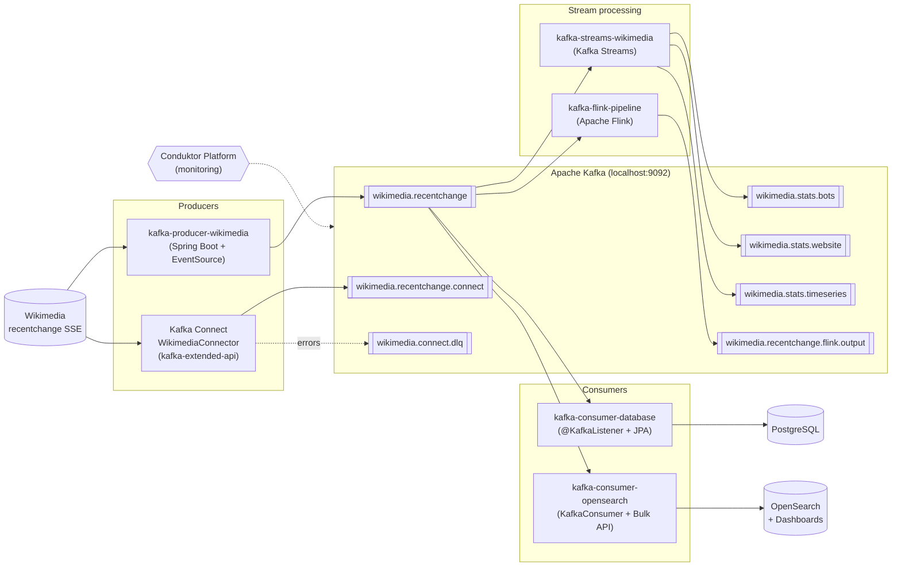

# apache-kafka-training-tasks

A project that collects hands-on training tasks on Apache Kafka (Spring Boot, Kafka Streams, Kafka Connect, Flink).
The data source is the public **Wikimedia Recent Changes** SSE stream
(`https://stream.wikimedia.org/v2/stream/recentchange`).

## Architecture



## Modules and use cases

| Module | Use case | Key concepts |
|---|---|---|
| [kafka-producer-wikimedia](kafka-producer-wikimedia) | Reads the Wikimedia stream via `EventSource` and publishes each event (JSON as `String`) to the `wikimedia.recentchange` topic | `KafkaTemplate`, `StringSerializer`, topic auto-creation via `NewTopic`/`TopicBuilder`, `EventHandler` |
| [kafka-consumer-database](kafka-consumer-database) | Persists every event from the topic into PostgreSQL | `@KafkaListener`, consumer group `myGroup`, `auto-offset-reset: earliest`, Spring Data JPA |
| [kafka-consumer-opensearch](kafka-consumer-opensearch) | Indexes events into OpenSearch (`wikimedia` index) for search and visualization | Plain `KafkaConsumer`, manual offset commits (`enable.auto.commit=false`), batch inserts via Bulk API, idempotency (`meta.id` as document id), graceful shutdown (`wakeup()`), `docker-compose` with OpenSearch and Dashboards |
| [kafka-streams-wikimedia](kafka-streams-wikimedia) | Computes real-time statistics and writes them to separate topics | See below |
| [kafka-extended-api](kafka-extended-api) | Kafka Connect (standalone) configuration with the Wikimedia source connector | `connect-standalone.properties`, `WikimediaConnector`, `JsonConverter`, Dead Letter Queue (`errors.tolerance=all`) |
| [kafka-flink-pipeline](kafka-flink-pipeline) | Reads `wikimedia.recentchange`, transforms (maps) messages and writes them to `wikimedia.recentchange.flink.output` | `FlinkKafkaConsumer`/`FlinkKafkaProducer`, `MapFunction`, custom `WikimediaData` (de)serializers, `setStartFromEarliest()` |
| [conduktor-platform](conduktor-platform) | Docker Compose for Conduktor Platform, a UI for browsing topics, messages and consumer groups | Cluster monitoring and administration |

### Kafka Streams: statistics

All three topologies read from `wikimedia.recentchange`:

| Topology | What it counts | Window | Output topic | State store |
|---|---|---|---|---|
| `BotCountStreamBuilder` | Changes made by bots vs. non-bots | none | `wikimedia.stats.bots` | `bot-count-store` |
| `WebsiteCountStreamBuilder` | Changes per website (`server_name`) | tumbling, 1 min | `wikimedia.stats.website` | `website-count-store` |
| `EventCountTimeseriesBuilder` | Total event count (time series) | tumbling, 10 s | `wikimedia.stats.timeseries` | `event-count-store` |

Operations used: `mapValues`, `selectKey`, `groupBy`/`groupByKey`, `windowedBy`, `count`, `toStream`, `to`.

## Running

Requirements: JDK, Maven, Kafka on `localhost:9092`.

```bash
# build all modules
mvn clean install

# supporting infrastructure
docker compose -f kafka-consumer-opensearch/docker-compose.yaml up -d   # OpenSearch :9200, Dashboards :5601
docker compose -f conduktor-platform/platform-docker-compose.yml up -d  # Conduktor Platform
```

`kafka-consumer-database` expects PostgreSQL on `localhost:5432` (database `wikimedia`).
Each module runs as a separate Spring Boot application (`mvn spring-boot:run -pl <module>`).

## Dependency updates (Dependabot)

Dependencies are kept up to date by [Dependabot](.github/dependabot.yml), which checks weekly (max 5 open PRs per entry):

- **Maven**: the root `pom.xml` and each module (`kafka-consumer-database`, `kafka-consumer-opensearch`, `kafka-extended-api`, `kafka-flink-pipeline`, `kafka-producer-wikimedia`, `kafka-streams-wikimedia`). Modules are listed separately because Dependabot does not descend into sub-modules on its own.
- **Docker Compose**: `kafka-consumer-opensearch` and `conduktor-platform` images.

Pull request policy:

- **Linear history**: merge commits are disabled in the repository. Merge PRs with rebase (or squash), e.g. `gh pr merge <number> --rebase`.
- **Safe to merge**: patch/minor bumps whose build passes (`mvn test-compile`).
- **Closed with `@dependabot ignore this major version`**: breaking upgrades that need a dedicated migration, for example Spring Boot 4.x, `okhttp-eventsource` 5.x/6.x and Confluent Platform 8.x (drops ZooKeeper).
- **Upgrade together**: OpenSearch client and server (`opensearch-rest-high-level-client` and the `opensearch` / `opensearch-dashboards` images), and the Conduktor Platform and Cortex images.
- There is no CI yet, so there are no automatic checks on PRs. Verify the build locally before merging.

## Security

- **Vulnerable transitive dependencies** are pinned to patched versions in the root `pom.xml` and in the four modules that use the Spring Boot parent directly (Spring Boot properties plus `dependencyManagement`): `jackson-core`, `log4j-api`, `postgresql`, `commons-lang3`, `lz4-java`, `snappy-java`, `commons-io`, `commons-compress`, `okhttp` and `okio`. The Flink module replaces `org.lz4:lz4-java` with the maintained `at.yawk.lz4` fork.
- **Scanning**: resolved dependencies can be checked against [OSV](https://osv.dev) (for example with `osv-scanner`); GitHub Dependabot alerts are also available in the repository's Security tab.
- **Known open issue**: `org.opensearch:opensearch:1.2.4` (GHSA-6g3j-p5g6-992f). Fixing it needs a coordinated OpenSearch client and server upgrade.
- **Credentials**: `kafka-consumer-database` reads the database settings from `DB_URL`, `DB_USERNAME` and `DB_PASSWORD` (defaults are for local development only). The passwords in `conduktor-platform` (`change_me`, `admin`) are also local defaults, so do not expose that stack publicly.

## Roadmap

1. Core concept and API — ✅ producer, consumers (Spring + plain client)
2. Kafka Extended API — 🚧 Kafka Connect, Kafka Streams, Flink (Connect configs are ready, `Main` is a stub)
3. Kafka Stream Registry and REST Proxy — TBD
4. Kafka Administration, Production setup and Security — TBD
